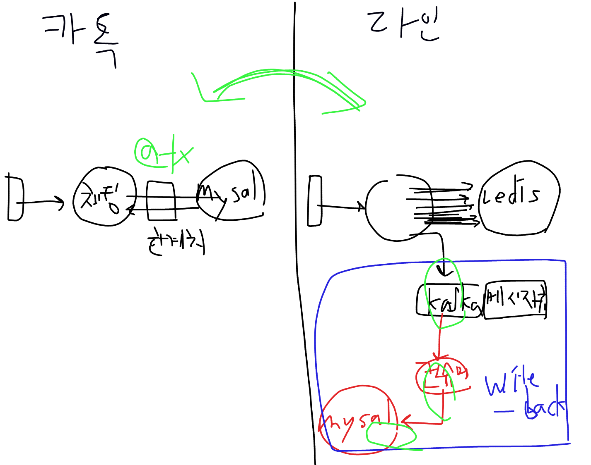

# 7회차(2026/10/13) — Cache와 Redis

- 예습 자료: [PRESTUDY.md](./PRESTUDY.md)
- 실습: [redis-cli 실습](./practice/redis-cli/README.md), [Spring 실습](./practice/spring/README.md)

---

## 1. Cache란

### 1.1 정의

**캐시(Cache)**: 느린 저장소에 있는 데이터를 **더 빠르고 가까운 저장소에 복사해 두고 재사용하는 것**.

- **Cache Hit**: 찾는 데이터가 캐시에 있다 → 빠른 곳에서 바로 꺼낸다.
- **Cache Miss**: 캐시에 없다 → 느린 원본까지 가서 가져오고, 다음을 위해 캐시에 복사해 둔다.

**왜 효과가 있나 — 지역성(Locality)**

캐시가 통하는 이유는 데이터 접근에 패턴이 있기 때문이다.

- **시간 지역성**: 방금 쓴 데이터를 곧 또 쓴다. (인기 상품 상세를 1분 안에 수천 명이 본다)
- **공간 지역성**: 방금 쓴 데이터의 근처 데이터를 곧 쓴다. (배열을 순서대로 읽는다)

모든 데이터가 골고루 한 번씩만 쓰인다면 캐시는 쓸모가 없다. **같은 데이터를 반복해서 쓰기 때문에** 복사해 둘 가치가 생긴다.

이 개념은 Redis만의 것이 아니다. **하드웨어, 네트워크, 애플리케이션 모든 층에 같은 원리**가 있다.

### 1.2 하드웨어 캐시 — 메모리 계층 구조

> 수업 링크: [Memory Hierarchy](https://computerscience.chemeketa.edu/cs160Reader/ComputerArchitecture/MemoryHeirarchy.html)

```text
           빠름 · 작음 · 비쌈
   ┌──────────────────────┐
   │  Register            │  ~0.3ns   CPU 안 (6회차 x++의 load/add/store)
   ├──────────────────────┤
   │  L1 / L2 / L3 Cache  │  ~1~40ns  CPU 안
   ├──────────────────────┤
   │  RAM (메모리)         │  ~100ns   ← Redis가 데이터를 두는 곳
   ├──────────────────────┤
   │  SSD                 │  ~100µs   ← MySQL 데이터 파일이 있는 곳
   ├──────────────────────┤
   │  HDD                 │  ~10ms
   └──────────────────────┘
           느림 · 큼 · 쌈
```

(시간은 크기 비교를 위한 대략적인 값이다.)

**핵심 원리**: 모든 계층은 **바로 아래 계층의 캐시**다.

- CPU는 RAM이 느리므로 자주 쓰는 값을 L1~L3 캐시에 복사해 둔다.
- RAM은 SSD가 느리므로, OS와 MySQL이 자주 읽는 디스크 페이지를 메모리에 올려 둔다. (6회차 B+Tree 페이지)

**왜 전부 빠른 것으로 만들지 않나**: 빠를수록 비싸고 용량이 작다. 그래서 **작고 빠른 곳에는 자주 쓰는 것만, 크고 느린 곳에는 전부** 두는 구조가 된다.

**Redis와의 연결**: RAM(~100ns)과 SSD(~100µs)는 **약 1000배** 차이가 난다. Redis가 빠른 근본 이유는 데이터를 RAM에 두기 때문이다. 반대로 RAM은 비싸고 작으므로 **Redis에는 자주 쓰는 것만** 넣어야 한다. (4장 메모리 관리)

### 1.3 네트워크 캐시 — CDN

> 수업 링크: [Content Delivery Network Basics](https://golangdocs.com/content-delivery-network-basics)

**CDN (Content Delivery Network)**: 원본 서버(Origin)의 파일을 **전 세계 곳곳의 엣지 서버(Edge)** 에 복사해 두고, 사용자는 **가장 가까운 엣지**에서 받게 하는 네트워크.

```text
CDN 없음:  서울 사용자 ───────────── 미국 원본 서버   (멀다 → 왕복 수백 ms)

CDN 있음:  서울 사용자 ── 서울 엣지 서버  ──(miss일 때만)── 미국 원본 서버
                         (복사본 보관)
```

- **hit**: 서울 엣지에 파일이 있으면 바로 받는다 → 빠르고, 원본 서버 부하도 없다.
- **miss**: 엣지가 원본에서 받아 오고, 복사해 둔다.
- **얼마나 보관하나**: HTTP 응답 헤더 `Cache-Control: max-age=...`로 정한다 → Redis의 **TTL과 같은 개념**.

**주로 캐싱하는 것**: 이미지, JS·CSS 번들, 동영상처럼 **모든 사용자에게 같은 정적 파일**. 프론트엔드 배포 시 CloudFront, Cloudflare를 앞에 두는 것이 이것이다.

**공통 공식**: 하드웨어든 네트워크든 같다.

> **느리거나 먼 원본** + **빠르거나 가까운 복사본** + **얼마나 보관할지(TTL)**

### 1.4 Local Cache vs Remote Cache

> 수업 그림: [local cache vs remote cache](https://ibb.co/hxxZNV7J)

애플리케이션 서버에서 캐시를 **어디에** 둘지의 선택이다.

```text
Local Cache                              Remote Cache
┌─ Server A ─┐  ┌─ Server B ─┐           ┌─ Server A ─┐  ┌─ Server B ─┐
│ [캐시 A]   │  │ [캐시 B]   │           │            │  │            │
└────┬───────┘  └────┬───────┘           └─────┬──────┘  └─────┬──────┘
     └──────┬────────┘                         └──────┬────────┘
           DB                                    [Redis 캐시]
                                                       │
                                                      DB
```

|                | **Local Cache**                                  | **Remote Cache**                                  |
| -------------- | ------------------------------------------------ | ------------------------------------------------- |
| 위치           | 서버 자기 메모리 (JVM 힙)                        | 서버 밖 별도 서버                                 |
| 예             | `ConcurrentHashMap`, Caffeine                    | **Redis**                                         |
| 속도           | **가장 빠름** (네트워크 없음)                    | 빠름 (네트워크 왕복 1번)                          |
| 서버 간 일관성 | ❌ 서버마다 따로 → A에서 지운 캐시가 B에는 남는다 | ✅ 모든 서버가 같은 값                            |
| 서버 재시작    | 사라진다                                         | 유지된다                                          |
| 용량           | 서버 메모리를 나눠 쓴다 (GC 부담)                | Redis 메모리만큼 따로                             |
| 운영 부담      | 없음                                             | Redis 서버를 따로 운영해야 한다. Redis 장애 = 캐시 장애 |

**선택 기준**

- **Local**: 거의 안 바뀌고, 서버마다 조금 달라도 괜찮은 작은 데이터. (설정값, 코드표, 카테고리 목록)
- **Remote**: 서버가 여러 대이고 **모든 서버가 같은 값을 봐야** 하는 데이터. 대부분의 조회 캐시. (1회차 stateless와 같은 이유)

> 🟢 참고: 트래픽이 아주 큰 서비스는 둘을 겹쳐 쓴다. Local에서 먼저 찾고, 없으면 Redis, 그래도 없으면 DB. 하드웨어의 L1 → L2 → RAM과 같은 계층 구조다.

### 1장 요약

| 개념            | 한 줄                                                         |
| --------------- | ------------------------------------------------------------- |
| 캐시            | 느린 원본의 데이터를 빠른 곳에 복사해 두고 재사용             |
| 지역성          | 같은 데이터를 반복해서 쓰기 때문에 캐시가 통한다              |
| 하드웨어        | 레지스터 → L1~L3 → RAM → SSD. 각 계층은 아래 계층의 캐시      |
| 네트워크        | CDN: 가까운 엣지에 정적 파일 복사. `max-age` = TTL            |
| Local vs Remote | Local은 가장 빠르지만 서버마다 따로, Remote(Redis)는 모든 서버가 공유 |

---

## 2. Redis 자료구조 — 볼 때 중요한 것은 "복잡도"

> 수업 링크: [Redis Cheat Sheet](https://redis.io/learn/howtos/quick-start/cheat-sheet)

### 2.1 왜 복잡도를 보나

Redis는 **명령을 한 번에 하나씩** 실행한다(3장). 그래서 느린 명령 하나가 실행되는 동안 **다른 모든 요청이 기다린다.** 명령이 데이터 개수(N)에 비례해 느려지는지(O(N)), 항상 일정한지(O(1))가 곧 장애 여부를 가른다.

| 표기         | 의미                              |
| ------------ | --------------------------------- |
| **O(1)**     | 데이터가 많아도 시간이 일정        |
| **O(log N)** | 데이터가 2배가 돼도 한 단계만 늘어남 |
| **O(N)**     | 데이터 개수에 비례 → **조심**     |

복잡도는 공식 문서의 명령마다 `Time complexity`로 적혀 있다.

### 2.2 조심해야 할 O(N) 명령

대부분의 기본 명령(`SET`, `GET`, `INCR`, `HSET`, `HGET`, `LPUSH`, `LPOP`, `SADD`, `EXPIRE`)은 **O(1)** 이라 안전하다. Sorted Set의 `ZADD`는 정렬을 유지하느라 **O(log N)** 이지만 역시 안전하다.

조심할 것은 **"전부 꺼내기 / 전부 훑기 / 큰 키 지우기"** 다.

| ❌ O(N) 명령              | 위험한 경우                  | ✅ 대안                                   |
| ------------------------- | ---------------------------- | ----------------------------------------- |
| `KEYS 패턴`               | 키가 많은 운영 서버          | `SCAN 0 MATCH 패턴`                       |
| `HGETALL`, `SMEMBERS`     | 원소가 아주 많은 키          | 필요한 것만 `HGET`, 또는 `HSCAN`/`SSCAN`  |
| `LRANGE key 0 -1`         | 긴 List                      | `LRANGE key 0 9`처럼 필요한 만큼만        |
| 큰 컬렉션 키 `DEL`        | 원소 수십만 개 이상          | `UNLINK` (메모리 해제를 백그라운드에서)   |

**Big Key**: 원소가 지나치게 많은 키 하나. 처음부터 `like:post:1`처럼 **키를 쪼개서** 설계해 만들지 않는 것이 가장 좋다.

### 2장 요약

```text
✅ O(1), O(log N)           → 그냥 쓴다
⚠️ O(N)                     → "이 키의 N이 얼마나 커질 수 있나?" 먼저 확인
❌ KEYS, FLUSHALL (운영)     → 쓰지 않는다
```

---

## 3. Redis 싱글 스레드

**Redis는 명령 실행을 스레드 하나가 순서대로 처리한다.** 여러 서버가 동시에 보내도 Redis 안에서는 줄을 세워 하나씩 실행한다.

| 장점                                              | 위험                                                        |
| ------------------------------------------------- | ----------------------------------------------------------- |
| 락이 필요 없고, **명령 하나는 원자적**이다 (`INCR` 안전) | **오래 걸리는 명령 하나가 실행되는 동안 모든 요청이 기다린다** |

### 🔴 레디스를 쓸 때 주의할 점

```text
Redis: [ KEYS * ............ 3초 ............ ][GET][GET]
서버 A GET: 기다림 ─────────────────────────▶ timeout 실패
서버 B GET: 기다림 ─────────────────────────▶ timeout 실패
```

오래 걸리는 명령 하나를 보내는 순간, 그 명령이 끝날 때까지 **모든 Redis 요청이 실패할 수 있다.** 캐시·세션·락을 Redis에 두었다면 서비스 전체 장애가 된다. MySQL의 느린 쿼리는 그 요청만 느리게 하지만, Redis는 **모든 요청**을 느리게 한다.

**→ 오래 걸리는 명령을 실행하지 않는다.**

- `KEYS` 대신 `SCAN`, 큰 키 `DEL` 대신 `UNLINK` (2장)
- 값은 작게, 키는 쪼개서
- 느린 명령 확인: `SLOWLOG GET 10`

---

## 4. Redis 메모리 관리

### 4.1 왜 예민하게 봐야 하나

Redis는 데이터를 **RAM에** 둔다(1장). RAM은 작고 비싸므로 **넣기만 하고 지우지 않으면 반드시 꽉 찬다.**

| 설정                                     | 꽉 차면                                           |
| ---------------------------------------- | ------------------------------------------------- |
| `maxmemory` 없음 (기본값 0 = 무제한)     | 서버 메모리를 끝까지 쓴다 → OS가 Redis를 강제 종료할 수 있다 |
| `maxmemory` + `noeviction` (기본 정책)   | 새로운 쓰기가 **에러로 거부**된다                 |
| `maxmemory` + `allkeys-lru`              | **오래 안 쓴 키부터 자동 삭제** → 캐시 용도에 주로 쓴다 |

### 4.2 `INFO memory` — 항상 확인한다

실습 Redis의 실제 값:

```text
used_memory_human:1.15M          ← ① 지금 사용량 (가장 중요)
used_memory_dataset:218816       ← ② 그중 내 키·값 데이터 (약 214KB)
used_memory_overhead:984160      ←    Redis 자체 운영 메모리
used_memory_peak_human:1.24M     ← ③ 켠 뒤 최대 사용량
maxmemory_human:0B               ← ④ 상한 (0 = 무제한)
maxmemory_policy:noeviction      ←    꽉 찼을 때 정책
mem_fragmentation_ratio:14.07    ← ⑤ OS 실제 점유 ÷ 사용량
```

| 항목                        | 볼 것                                                                    |
| --------------------------- | ------------------------------------------------------------------------ |
| ① `used_memory` ÷ ④ `maxmemory` | **상한에 얼마나 가까운가.** 보통 70~80%를 넘으면 알림                |
| ② `used_memory_dataset`     | 계속 늘기만 하면 TTL 없는 키가 쌓이는 중일 수 있다 (4.3)                 |
| ③ `used_memory_peak`        | 평소가 아니라 **최대치**가 상한에 닿은 적이 있는지                       |
| ⑤ `mem_fragmentation_ratio` | 데이터가 클 때만 의미. **1 미만이면 위험**(메모리 부족으로 디스크 swap 발생 → 급격히 느려짐). 지금 14는 데이터가 너무 작아서 생긴 값 |

`used_memory = dataset + overhead`다. 지금은 overhead가 시작 직후 기본량(`used_memory_startup` ≈ 958KB)과 거의 같아서, 메모리 대부분이 Redis 기본 사용량이고 실습 데이터는 214KB뿐이다.

함께 쓰는 명령:

- `INFO keyspace` → 키 개수와 TTL이 있는 키 개수 (`keys=6,expires=1`)
- `redis-cli --bigkeys` → 가장 큰 키 찾기 (2장 Big Key)

### 4.3 🔴 캐시를 저장했으면 삭제 사이클도 같이

캐시를 넣는 코드를 쓸 때 **"언제 지워지는가"를 같이 정한다.**

| 방법             | 언제 지워지나                                      |
| ---------------- | -------------------------------------------------- |
| **TTL**          | 정한 시간이 지나면 Redis가 자동 삭제 → **항상 기본으로** |
| **수정 시 삭제** | 원본(DB)이 바뀔 때 직접 삭제 (`DEL`, `@CacheEvict`) |

### 4.4 TTL (Time To Live)

> 수업 링크: [TTL 공식 문서](https://redis.io/docs/latest/commands/ttl/)

| 명령              | 뜻                                                              |
| ----------------- | --------------------------------------------------------------- |
| `SET 키 값 EX 초` | 저장 + 만료 시간                                                |
| `EXPIRE 키 초`    | 이미 있는 키에 만료 시간 지정                                   |
| `TTL 키`          | 남은 시간. **`-1` = 만료 없음 (삭제 사이클 누락!)**, `-2` = 키 없음 |

### 4장 요약

```text
1. 메모리는 작다 → 넣으면 지우는 방법도 같이 정한다
2. 캐시에는 항상 TTL
3. INFO memory로 used_memory와 maxmemory를 늘 확인
4. 운영에서는 maxmemory를 정하고, 캐시 용도면 allkeys-lru
```

---

## 5. 캐싱 전략

두 축으로 본다: **읽을 때 퍼올리나, 쓸 때 만들어 두나** / **정합성과 성능 중 무엇을 택하나**

### 5.1 읽을 때 퍼올리기 — Cache-Aside (실무 기본)

```text
조회:  Redis에 있나? ─ 있음 → 반환
                    └ 없음 → DB 조회 → Redis에 저장(TTL) → 반환
수정:  DB 수정 → Redis 캐시 삭제
```

- 장점: **실제로 조회되는 것만** 캐시에 올라간다. Redis가 죽어도 DB로 동작한다.
- 단점: **첫 조회는 항상 느리다**(miss). 수정과 삭제 사이에 잠깐 옛 값이 보일 수 있다.
- Spring의 `@Cacheable`이 이 방식이다.

### 5.2 쓸 때 만들어 두기 — Write-Through

```text
쓰기:  DB 저장 + Redis 저장 (같이)
조회:  Redis에서 바로
```

- 장점: 캐시가 **항상 최신**이고 첫 조회부터 hit.
- 단점: 쓰기마다 두 곳에 저장해 **쓰기가 느리다.** 안 읽힐 데이터도 올라가므로 여기도 TTL이 필요하다.

### 5.3 Write-Back (Write-Behind) — 정합성과 성능의 트레이드오프

```text
쓰기:  Redis에만 저장 → (나중에 모아서) DB에 반영
```

- 장점: 쓰기가 **가장 빠르다.** DB에 1000번 쓸 것을 1분에 한 번으로 모을 수 있다.
- 단점: DB 반영 전에 **Redis가 죽으면 그 데이터는 사라진다.** 그 사이 DB와 Redis 값도 다르다.

```text
정합성 ◀──────────────────────────────▶ 성능
 Write-Through     Cache-Aside      Write-Back
 (항상 일치)        (잠깐 어긋남)     (유실 가능, 가장 빠름)
```

쓰는 곳: 조회수·좋아요처럼 **쓰기가 아주 많고 조금 유실돼도 괜찮은** 데이터 (Redis `INCR`로 세다가 주기적으로 DB 반영). 결제·주문에는 쓰지 않는다.

### 5.4 선택 기준

| 전략            | 언제                                                 |
| --------------- | ---------------------------------------------------- |
| **Cache-Aside** | 대부분의 조회 캐시 → **기본으로 이것**               |
| Write-Through   | 쓰고 바로 읽는 일이 많고, 항상 최신이어야 할 때      |
| Write-Back      | 쓰기가 폭주하고, 약간의 유실을 감수할 수 있을 때     |

### 5.5 사례 — 카톡 vs 라인 (강사님 설명)



> 수업에서 설명을 위해 단순화한 비교다. 두 회사의 실제 내부 구조가 아니라 **두 가지 설계 방식**으로 이해한다.

메신저는 **쓰기(메시지 전송)가 엄청나게 많은** 서비스라, 쓰기를 어떻게 처리하느냐가 핵심이다.

**카톡 방식 — DB에 바로, 트랜잭션으로**

```text
사용자 ─▶ 채팅 서버 ─(@Transactional)─▶ MySQL 저장 ─▶ 응답 "전송 완료"
```

- 장점: **정합성 100%.** "전송 완료"를 받은 메시지는 반드시 DB에 있다. 구조가 단순하다.
- 단점: **DB가 곧 서비스의 한계.** 새해 0시처럼 폭증하면 모든 메시지가 MySQL 쓰기를 기다린다. 쓰기는 Primary 한 대에 몰려 늘리기 어렵다(1회차).

```text
DB 쓰기 지연 → 커넥션 풀 고갈(3회차) → Tomcat 스레드 대기 → "카톡이 느려요"
```

**라인 방식 — Write-Back (Redis + Kafka)**

```text
사용자 ─▶ 채팅 서버 ─▶ Redis 저장 ─▶ 바로 응답 "전송 완료"     ← 빠른 경로
                    └─▶ Kafka에 이벤트 발행 ─▶ 컨슈머 ─▶ MySQL 저장   ← 나중에 반영
```

- 장점: 사용자는 **Redis 저장 속도**로 응답받는다. 폭증이 와도 **Kafka가 완충**하고, 컨슈머는 DB가 감당할 속도로 꺼내 저장한다.
- Kafka가 중간에 있는 이유: Redis만 쓰면 DB 반영 전 Redis가 죽을 때 메시지가 사라진다. Kafka는 메시지를 **디스크에 보관하고 다시 처리**할 수 있어 유실 위험을 줄인다.

**"100% 정합성을 포기했다"의 뜻**

- Redis에는 있는데 MySQL에는 **아직 없는 시간**이 있다.
- 유실 가능성을 줄였을 뿐 0은 아니다.
- 대신 "결국에는 DB에 반영된다"를 보장한다 → **최종 일관성(Eventual Consistency)**. (1회차 replication lag와 같은 종류)

**그럼 라인 방식이 더 좋은가? → 트레이드오프**

| 라인 방식이 치르는 대가 | 설명                                                          |
| ----------------------- | ------------------------------------------------------------- |
| 정합성 지연             | DB에 늦게 반영된다                                            |
| 복잡도·운영 비용        | 서버+DB 2개 → 서버+Redis+Kafka+컨슈머+DB 5개. 각각 운영·모니터링 |
| 새로운 문제             | 컨슈머 재시도 시 **중복 저장**, 메시지 **순서** 보장 (1회차 MQ) |

```text
정합성 ◀─────────────────────────────▶ 성능
 카톡 방식 (DB 직접 + 트랜잭션)          라인 방식 (Redis + Kafka write-back)
 단순, 100% 정합성, 폭증에 약함           빠름, 폭증에 강함, 최종 일관성, 복잡함
```

**선택 기준 — "잠깐 늦게 반영되거나 드물게 유실되면 얼마나 큰 문제인가?"**

| 데이터                      | 선택                                       |
| --------------------------- | ------------------------------------------ |
| 채팅 메시지, 조회수, 좋아요 | 속도 우선, 잠깐의 지연 허용 → Write-Back 검토 |
| 송금, 결제, 주문            | 한 건도 틀리면 안 됨 → DB 직접 + 트랜잭션  |

정답인 구조는 없다. **서비스가 무엇을 포기할 수 있는지**에 따라 고른다.

---

## 6. Java Redis 클라이언트 — Lettuce

**클라이언트 라이브러리**: Java 코드와 Redis 서버 사이에서 **실제로 TCP 통신을 하는 라이브러리**. 3회차 MySQL JDBC Driver와 같은 자리다.

|                    | **Lettuce**                                                   | Jedis                               |
| ------------------ | ------------------------------------------------------------- | ----------------------------------- |
| Spring Boot 기본값 | ✅                                                            | 따로 설정해야 한다                  |
| 연결 공유          | **연결 하나를 여러 스레드가 같이 써도 안전** → 기본은 풀 없이 동작 | 한 연결을 한 스레드만 → 커넥션 풀 필수 |
| 방식               | 비동기 기반(Netty), 동기·비동기 모두 지원                     | 단순한 동기 방식                    |

실무에서 Lettuce를 쓰는 이유: **Spring Boot 기본값이고, Tomcat 스레드 200개가 연결 하나를 공유해도 안전해** 설정할 것이 적다.

**직접 쓸 일은 거의 없다.** `spring-boot-starter-data-redis`에 포함되어 자동으로 들어오고, 코드에서는 7장의 `RedisTemplate`만 쓴다. 에러 로그에 `io.lettuce.core.RedisConnectionException`이 보이면 "Redis 연결 문제"로 읽는다.

---

## 7. Spring Data Redis

### 7.1 구조

```text
내 Service ──▶ RedisTemplate (Spring Data Redis) ──▶ Lettuce ──▶ Redis 서버
               사용하기 편한 겉포장                   실제 통신
```

### 7.2 Lettuce 세팅 = 의존성 1줄 + 설정 2줄

```groovy
implementation 'org.springframework.boot:spring-boot-starter-data-redis'   // Spring Data Redis + Lettuce
```

```properties
spring.data.redis.host=localhost
spring.data.redis.port=6380
```

Spring Boot가 **Lettuce 연결(`RedisConnectionFactory`)과 `StringRedisTemplate`을 Bean으로 자동 생성**한다(2회차 Bean). 생성자로 주입받기만 하면 된다.

### 7.3 RedisTemplate 사용 — cli 명령 = Java 메서드

```java
@Service
@RequiredArgsConstructor
public class AuthCodeService {
    private final StringRedisTemplate redisTemplate;

    public void save(Long userId, String code) {
        redisTemplate.opsForValue().set("auth:code:" + userId, code, Duration.ofMinutes(3));   // SET ... EX 180
    }
    public String find(Long userId) {
        return redisTemplate.opsForValue().get("auth:code:" + userId);                       // GET
    }
}
```

| Java                                        | Redis 명령      |
| ------------------------------------------- | --------------- |
| `opsForValue().set(k, v, Duration)`         | `SET k v EX`    |
| `opsForValue().get(k)`                      | `GET k`         |
| `opsForValue().increment(k)`                | `INCR k`        |
| `opsForValue().setIfAbsent(k, v, Duration)` | `SET k v NX EX` |
| `opsForHash().put(k, f, v)` / `.get(k, f)`  | `HSET` / `HGET` |
| `delete(k)` / `getExpire(k)`                | `DEL` / `TTL`   |

`opsForValue()`는 String, `opsForHash()`는 Hash, `opsForList()`·`opsForSet()`·`opsForZSet()`은 각 자료구조의 명령 모음이다.

### 7.4 StringRedisTemplate vs RedisTemplate

|                                   | 저장 형식                                         | 언제                                   |
| --------------------------------- | ------------------------------------------------- | -------------------------------------- |
| **`StringRedisTemplate`**         | key·value 모두 문자열                             | **문자열, 숫자(카운터), 토큰** → 기본 선택 |
| `RedisTemplate<K, V>` (기본 설정) | Java 직렬화 → cli에서 `"\xac\xed\x00..."`처럼 깨져 보인다 | 그대로는 쓰지 않는다             |

**객체를 저장할 때**는 `RedisTemplate`을 직접 Bean으로 만들어 **key는 문자열, value는 JSON**으로 설정한다.

```java
@Bean
public RedisTemplate<String, Object> redisTemplate(RedisConnectionFactory connectionFactory) {
    RedisTemplate<String, Object> template = new RedisTemplate<>();
    template.setConnectionFactory(connectionFactory);
    template.setKeySerializer(RedisSerializer.string());    // 키: 문자열
    template.setValueSerializer(RedisSerializer.json());    // 값: JSON
    return template;
}
```

실습: [Spring 실습 1](./practice/spring/README.md#1-stringredistemplate-기본) — API로 저장한 `otp` 키가 redis-cli에서 그대로 보이고 `TTL otp`가 60으로 나온다.

### 6·7장 요약

| 개념          | 한 줄                                                         |
| ------------- | ------------------------------------------------------------- |
| Lettuce       | 실제로 Redis와 통신하는 클라이언트. Spring Boot 기본값, 연결 공유 |
| 세팅          | `spring-boot-starter-data-redis` + `host`/`port` → Bean 자동 생성 |
| RedisTemplate | Redis 명령의 Java 버전 (`opsForValue().set` = `SET`)          |
| 기본 선택     | `StringRedisTemplate`. 객체는 `RedisTemplate` + JSON 직렬화   |

---

## 8. Spring Cache

> 수업 링크: [Baeldung — A Guide To Caching in Spring](https://www.baeldung.com/spring-cache-tutorial)

### 8.1 정의

**Spring Cache**: 메서드에 애노테이션을 붙이면 **5장의 Cache-Aside를 Spring이 대신** 해 주는 기능. 7장처럼 `RedisTemplate` 코드를 직접 쓰지 않는다.

**캐시 추상화**: Spring Cache는 "캐시를 쓰는 방법"만 정하고, 실제 저장소는 설정으로 고른다.

```text
@Cacheable ─▶ CacheManager ─┬─ RedisCacheManager     (spring.cache.type=redis)
                            └─ CaffeineCacheManager  (로컬 캐시, 1장 Local)
```

3회차 `DataSource` ↔ `HikariCP`와 같은 관계다. 코드는 그대로 두고 **저장소만 바꿀 수 있다.**

### 8.2 설정

```groovy
implementation 'org.springframework.boot:spring-boot-starter-cache'
implementation 'org.springframework.boot:spring-boot-starter-data-redis'
```

```properties
spring.cache.type=redis
```

```java
@EnableCaching          // 캐시 애노테이션 켜기 (설정 클래스에 한 번)
@Configuration
public class CacheConfig { }
```

### 8.3 애노테이션

| 애노테이션        | 동작                                                                         | 언제                 |
| ----------------- | ---------------------------------------------------------------------------- | -------------------- |
| **`@Cacheable`**  | 캐시에 있으면 **메서드를 실행하지 않고** 캐시 값 반환. 없으면 실행 후 저장   | **조회**             |
| **`@CacheEvict`** | 메서드 실행 후 캐시 삭제 (`allEntries = true`면 그 캐시 전체)                | **수정·삭제**        |
| `@CachePut`       | **항상** 메서드를 실행하고 결과로 캐시를 덮어씀                              | 갱신 (보통은 Evict를 더 쓴다) |
| `@CacheConfig`    | 클래스에 붙여 `cacheNames`를 공통 지정                                       | 반복 줄이기          |

```java
@Cacheable(cacheNames = "product", key = "#id")
public Product getProduct(Long id) { ... }

@CacheEvict(cacheNames = "product", key = "#id")
public Product updatePrice(Long id, int price) { ... }
```

- Redis 키: **`캐시이름::key`** → `product::1`
- `key = "#id"`: 파라미터 `id`의 값으로 키를 만든다
- `unless = "#result == null"`: 결과가 null이면 저장하지 않는다

### 8.4 동작 원리 — 프록시

3회차 `@Transactional`과 같은 방식이다.

```text
Controller → [캐시 프록시] → 실제 Service 메서드
              ① product::1 조회
              ② 있으면 바로 반환 (실제 메서드 호출 안 함)
              ③ 없으면 메서드 실행 → 결과를 Redis에 저장
```

**실습 결과** (조회에 1초 걸리는 "느린 DB"로 실험, [Spring 실습 2](./practice/spring/README.md#2-spring-cache--cacheable-cacheevict))

| 요청         | 시간      | 일어난 일                              |
| ------------ | --------- | -------------------------------------- |
| 1번째 조회   | 1.08초    | miss → DB → 캐시 저장                  |
| 2·3번째 조회 | 24ms, 4ms | hit (메서드 안의 로그가 안 찍힌다)     |
| 가격 수정    | 7ms       | DB 수정 + `@CacheEvict`로 캐시 삭제    |
| 수정 후 조회 | 1.01초    | miss → 새 가격으로 다시 캐싱           |

### 8.5 🔴 주의점

| 주의                                                    | 이유                                            |
| ------------------------------------------------------- | ----------------------------------------------- |
| **TTL을 꼭 설정한다**                                   | 기본값은 TTL 없음 → 영원히 남는다 (4장 삭제 사이클) |
| **같은 클래스 안에서 `this.메서드()`로 부르면 동작하지 않는다** | 프록시를 거치지 않는다 (`@Transactional`과 같은 함정) |
| **public 메서드에 붙인다**                              | 프록시는 외부에서 호출되는 public 메서드를 가로챈다 |
| **정확해야 하는 데이터에는 쓰지 않는다**                | 잔액, 재고처럼 잠깐이라도 틀리면 안 되는 값     |

TTL 설정 (실습 프로젝트 `CacheConfig`):

```java
RedisCacheConfiguration.defaultCacheConfig()
        .entryTtl(Duration.ofMinutes(10))      // TTL 10분
        .serializeValuesWith(SerializationPair.fromSerializer(new JacksonJsonRedisSerializer<>(Product.class)));   // JSON 저장
```

### 8장 요약

| 개념            | 한 줄                                                          |
| --------------- | -------------------------------------------------------------- |
| Spring Cache    | Cache-Aside를 애노테이션으로. 저장소는 `CacheManager`로 교체 가능 |
| 설정            | starter-cache + `spring.cache.type=redis` + `@EnableCaching` + TTL |
| 핵심 애노테이션 | `@Cacheable`(조회), `@CacheEvict`(수정·삭제)                   |
| 원리            | 프록시. hit면 메서드를 실행하지 않는다                         |
| 주의            | TTL 필수, 자기 호출 미적용                                     |

---

## 다음 수업

Spring MVC, Redis 분산 락, Pub/Sub, Lua Script, Pipeline → [8회차 PRESTUDY](<../08회차(2026-10-21)/PRESTUDY.md>)
