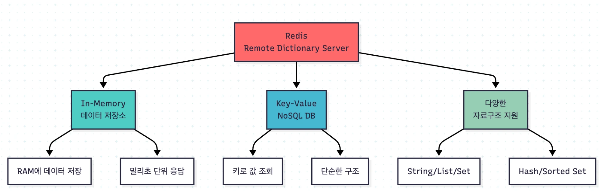
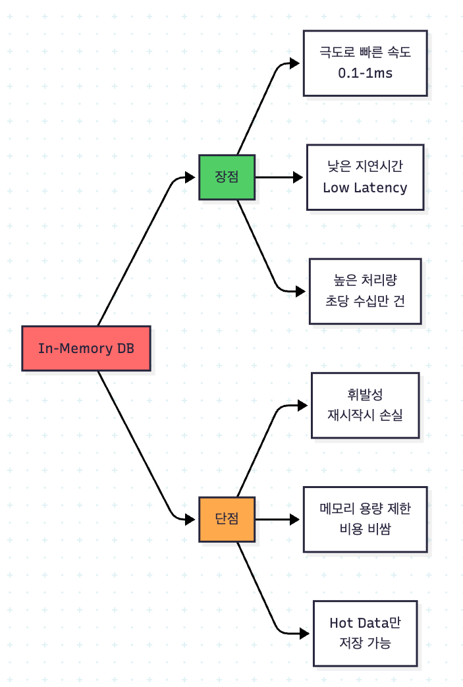

# 1장. Redis란

> **이 장을 마치면**: Redis가 무엇이고 왜 빠른지, 실무에서 어디에 쓰는지 설명할 수 있다. 그리고 Redis를 쓸 때 가장 중요한 성질 — **느린 명령 하나가 모든 요청을 멈춘다** — 를 직접 확인한다.

**실습 준비물**: [infra/slow-command.sh](./infra/slow-command.sh)

---

## 1. Redis란



> **Redis = 데이터를 메모리(RAM)에 저장하고, 키(이름)로 값을 찾는 저장소**

```text
키              값
user:1:name  →  "kim"
post:1:views →  "152"
```

| 특징 | 뜻 | 그래서 |
| ---- | -- | ------ |
| **메모리에 저장** (In-Memory) | MySQL처럼 디스크가 아니라 RAM에 둔다 | 응답이 1ms(1000분의 1초) 이하로 빠르다 |
| **키로 찾기** (Key-Value) | 테이블, SQL 없이 키 이름으로 값을 바로 꺼낸다 | 구조가 단순하다 |
| **여러 자료구조** | 값으로 문자열뿐 아니라 목록, 정렬된 목록 등을 저장한다 | 랭킹, 중복 제거를 Redis 안에서 바로 한다 (3장) |

## 2. 대신 포기한 것



| 약점 | 이유 | 실무에서는 |
| ---- | ---- | ---------- |
| **꺼지면 사라진다** | RAM은 전원이 꺼지면 내용이 지워진다 (디스크에 남기는 방법은 9장) | 원본은 MySQL 같은 DB에 두고, Redis에는 **복사본**이나 **잠깐 쓰는 데이터**를 둔다 |
| **많이 못 담는다** | RAM은 디스크보다 작고 비싸다 | **자주 읽는 데이터만** 넣고, 넣을 때 **언제 지울지**도 정한다 (2장 TTL) |

## 3. 실무에서 어디에 쓰나

| 용도 | 예 | 배우는 장 |
| ---- | -- | --------- |
| 캐시 | 상품 정보를 DB 대신 Redis에서 빠르게 읽기 | 5장 |
| 잠깐만 필요한 데이터 | 인증번호(3분), 로그인 세션 | 2장 |
| 숫자 세기 | 조회수, 좋아요 수 | 2장 |
| 랭킹 | 게임 점수 순위 | 3장 |
| 동시에 들어오는 요청 정리 | 재고 차감, 선착순 쿠폰 | 6장 |
| 서버끼리 알리기 | 여러 서버에 "캐시 지워" 전달 | 8장 |

공통점: **빨라야 하고, 잃어도 다시 만들 수 있거나 잠깐만 필요한 데이터.** 주문, 결제 같은 원본은 DB에 둔다.

## 4. 🔴 싱글 스레드 — 명령을 한 번에 하나씩 처리한다

**스레드** = 프로그램 안에서 일을 처리하는 작업자. Redis는 명령을 처리하는 작업자가 **1명**이다.

서버 100대가 동시에 명령을 보내도 Redis 안에서는 **줄을 세워 하나씩** 처리한다.

```text
들어온 순서:  [GET] [SET] [GET] [INCR] [GET] ...
처리:         하나 끝나면 다음, 하나 끝나면 다음
```

### 좋은 점 — 명령 하나는 절대 끊기지 않는다

명령 하나를 처리하는 도중에 다른 명령이 끼어들 수 없다. 그래서 2장의 `INCR`(1 더하기)은 1000명이 동시에 불러도 정확히 1000이 오른다.

### 🔴 위험한 점 — 오래 걸리는 명령 하나가 모두를 멈춘다

```text
처리:  [ 5초 걸리는 명령 .................... ][GET][GET][GET]
                                              ↑ 뒤에 선 명령들은 5초를 기다린다
```

MySQL에서 느린 쿼리는 **그 요청만** 느리다. Redis에서 느린 명령은 **모든 요청**을 느리게 한다. 캐시, 로그인, 락을 전부 Redis에 두었다면 서비스 전체가 멈춘다.

## 5. 🧪 실습 — 느린 명령이 다른 명령을 막는 것 보기

### 1단계. 터미널 B에서 접속해 둔다

```bash
docker exec -it redis-study redis-cli
```

```text
127.0.0.1:6379> SELECT 1
OK
```

### 2단계. 터미널 A에서 느린 명령 보내기

약 5초 동안 Redis를 붙잡는 명령을 보내는 스크립트다.

```bash
cd infra
./slow-command.sh
```

```text
느린 명령 실행 중... (약 5초)
```

### 3단계. 바로 터미널 B에서 GET 치기

| 입력 | 결과 | 확인할 것 |
| ---- | ---- | --------- |
| `GET anything` | 몇 초 동안 **아무 응답이 없다가** `(nil)` | 평소엔 바로 나오는 명령이 앞 명령이 끝날 때까지 기다렸다 |

### 4단계. 느린 명령 기록 보기 (터미널 B)

Redis는 **10ms보다 오래 걸린 명령**을 자동으로 기록한다 (SLOWLOG).

| 입력 | 결과 | 확인할 것 |
| ---- | ---- | --------- |
| `SLOWLOG GET 1` | `1) 1) (integer) 7`<br>`   2) (integer) 1793364652`<br>`   3) (integer) 4094391`<br>`   4) 1) "EVAL" ...` | 세 번째 숫자가 걸린 시간(마이크로초). 4094391 = **약 4.1초** |

> 운영 중 Redis가 느려지면 가장 먼저 `SLOWLOG GET 10`을 본다.

## 6. 그래서 지킬 규칙

느린 명령은 대부분 **"데이터를 전부 훑는"** 명령이다.

| ❌ 하지 않는다 | ✅ 대신 | 배우는 장 |
| -------------- | ------- | --------- |
| `KEYS *` (모든 키 훑기) | `SCAN` | 4장 |
| 원소 수십만 개짜리 목록을 통째로 조회 | 필요한 만큼만 조회 | 3장 |
| 오래 도는 Lua 스크립트 | 짧게 작성 | 6장 |

> 명령마다 얼마나 걸리는지는 공식 문서에 `Time complexity`로 적혀 있다. **O(1)** 은 데이터가 많아도 항상 빠르고, **O(N)** 은 데이터 개수(N)만큼 느려진다. O(N) 명령을 쓸 때는 "이 데이터가 얼마나 커질 수 있나?"를 먼저 생각한다.

---

## 정리

```text
Redis       = 메모리에 저장, 키로 찾기 → 아주 빠르다
약점        = 꺼지면 사라짐, 많이 못 담음 → 원본은 DB, Redis엔 복사본과 임시 데이터
싱글 스레드  = 명령을 하나씩 처리 → 명령 하나는 안전하지만, 느린 명령 하나가 전체를 멈춘다
```

## 면접 한 줄

- **Redis가 빠른 이유**: 데이터를 메모리에 두고, 단순한 Key-Value 구조로 바로 찾는다.
- **싱글 스레드**: 명령을 하나씩 실행해서 명령 하나는 원자적이다. 대신 오래 걸리는 명령 하나가 모든 요청을 막으므로 `KEYS` 같은 O(N) 명령을 피한다.

다음: [2장. String & TTL](./02-string-and-ttl.md)
